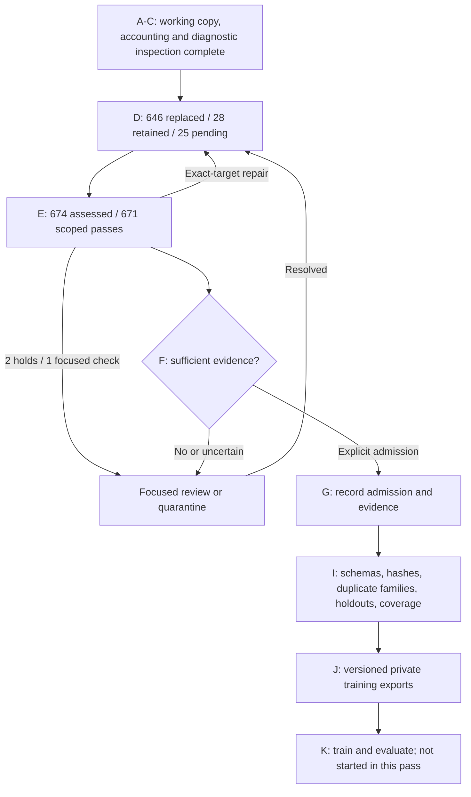

# Corpus Correction Checkpoint: D49 / E48

Updated 20 October 2026. This report covers the instruction-correction queue,
not the entire raw-language inventory or a training-ready dataset.

## Current Position

| Measure | Count |
| --- | ---: |
| Original queue work items | 699 |
| Distinct examples replaced | 646 |
| Examples retained after assessment | 28 |
| Original work items still pending | 25 |
| Current complete handoffs assessed for meaning | 674 |
| Scoped same-agent passes awaiting admission decisions | 671 |
| Source holds in the meaning-check handoff | 2 |
| Focused Twi wording checks in the meaning-check handoff | 1 |
| Corrected English derivatives, with original references preserved | 122 |
| Training admissions from this pass | 0 |

The 25 pending D items comprise 13 source-reference adjudications and 12
contextual examples. These are separate from the two E source holds and one
focused Twi check. Passing E is not native-speaker approval, independent
validation, clinical certification or training admission.

The working view still accounts for 52,002 instruction records, including
26,509 protected/excluded records. The targeted queue does not certify the
24,790 uninspected instruction-pool sources or the other collections.

## Latest Changes

D49 adds nine complete food, cooking and process examples. Repairs address
truncated instructions, ingredient identities, measurements, process order and
unsupported factual claims. Source-level corrections have separately labelled
English derivatives. Original English and Twi remain unchanged. Authored
completions are not presented as recovered source text.

E48 compares all nine full targets against their corrected references and
carries earlier exact-target assessments. Naturalness, style and unnecessary
repair commentary remain explicit admission-stage concerns. No recipe testing
or independent native review is claimed.

## Execution Map

Authenticated pages:

- [Complete examples and corrections](https://ghanahealth.serendepify.com/research/corpus/?collection=responses).
- [Latest batch](https://ghanahealth.serendepify.com/research/corpus/?collection=responses&offset=665).
- [Clickable execution map](https://ghanahealth.serendepify.com/research/corpus/progress).

The review projection preserves complete requests, context and answers. Where
the source answer was corrected, it shows that derivative beside the Twi and
keeps the original English separately accessible. Human decisions remain in
the existing append-only journal, tied to source and proposal hashes. A stale
proposal cannot silently inherit a previous selection.

## Evidence And Storage

- D49 manifest: `d555356db371603b1fb5b3b3b54bd213c519d3c4be91de7cb6a5f019f321aeae`.
- E48 manifest: `7baa35119c0f056974cd87b3b4f1351ad44ed9c8647d2b86e18cf7d749292b9f`.
- Review queue: 699 records, 674 proposals, 25 pending; SHA-256
  `6a97c64bc491a448dea2d4654c448fc8b24c59ad466f379b77f6436832f5bf97`.
- Private Modal backups: 288 remotely verified artifact files across 32
  continuation checkpoints since D34/E33. D49/E48 account for the newest 18.

This public repository holds code and aggregate progress, not the private
corpus, correction specifications, review records, audio or credentials.
The authenticated review service is isolated from public chat and uses the
existing journal directory. Updating it does not deploy the chat application.

## Verification And Next Work

The new projection has 12 focused tests for source integrity, complete meaning
handoffs, protected-source rejection, derivative bindings, pending examples,
false approvals, inventory conservation and safe rendering. The standalone
gateway tests exercise authentication, origin checks, idempotent saves,
stale-proposal handling and desktop/mobile layouts using disposable fixtures.
These are software tests, not a Twi accuracy benchmark.

Continue the remaining 25 complete-example corrections and meaning checks.
Then make explicit F admission decisions, resolve focused uncertainty, and
validate the final exports. Language learning, alignment, direct conversation,
and health/commerce/tool data retain separate readiness requirements. No new
training run, ASR/TTS change or public dataset upload is part of this update.
